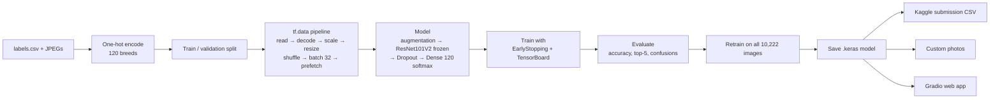

# 🐶 Dog Vision — End-to-End Dog Breed Classification with Transfer Learning

[](https://colab.research.google.com/github/Manikanta-Chilaka/dog-vision/blob/main/dog_vision.ipynb)

A deep learning project that identifies the **breed of a dog from a photo**, choosing from **120 breeds**.
It covers the full machine learning workflow: exploring raw images, building a `tf.data` input pipeline, transfer learning with **ResNet101V2**, evaluation, training on the full dataset, predictions for the 10,357-image test set in Kaggle submission format, and a **Gradio web demo**.

**Tech stack:** Python · TensorFlow 2 / Keras · NumPy · pandas · scikit-learn · Matplotlib · TensorBoard · Gradio · Google Colab (T4 GPU)

---

## Table of contents
1. [Problem](#1-problem)
2. [Data](#2-data)
3. [How it works, start to end](#3-how-it-works-start-to-end)
4. [Results](#4-results)
5. [Project structure](#5-project-structure)
6. [How to run it](#6-how-to-run-it)
7. [Key concepts explained](#7-key-concepts-explained)
8. [Interview prep: likely questions and answers](#8-interview-prep-likely-questions-and-answers)
9. [Limitations and next steps](#9-limitations-and-next-steps)

---

## 1. Problem

> Given an image of a dog, predict its breed.

This is a **multi-class image classification** problem: every image belongs to exactly one of 120 classes.
Telling apart 120 breeds is hard: many look very similar (e.g. *Siberian husky* vs *Malamute*), and the photos vary in lighting, angle, background and quality.

## 2. Data

Source: [Kaggle — Dog Breed Identification](https://www.kaggle.com/c/dog-breed-identification/data) (a subset of the Stanford Dogs / ImageNet data).

| File | Contents |
|---|---|
| `train/` | 10,222 labelled JPEG images |
| `test/` | 10,357 unlabelled JPEG images |
| `labels.csv` | `id` (image file name) → `breed` |

* **120 breeds**, with between 66 and 126 images each, so the classes are fairly **balanced**.
* Kaggle evaluates **multi-class log loss** on a CSV that holds a probability for every breed for every test image.

## 3. How it works, start to end



### Step 1: Setup
The notebook runs in **Google Colab** with a **GPU** runtime. The dataset is stored in Google Drive (`MyDrive/Dog-Vision/`), which is mounted into Colab. All paths are defined once (`DATA_DIR`, `TRAIN_DIR`, ...).

### Step 2: Explore the data
* `labels.csv` is loaded with pandas. There are 10,222 unique ids and 120 unique breeds.
* A bar chart of images per breed shows the classes are roughly balanced, so **accuracy** is a fair metric.
* We check that the number of file paths matches the number of files on disk.

### Step 3: Turn labels into numbers
Models work with numbers, not strings. Each breed name becomes a **one-hot vector** of length 120:

```python
unique_breeds = np.unique(breed_labels)                 # 120 sorted breed names
boolean_labels = [label == unique_breeds for label in breed_labels]
# 'boston_bull' → [False, ..., True (index 19), ..., False]
```

### Step 4: Train/validation split
Kaggle's test set has no labels, so we create our own **validation set** (20%) with `train_test_split(random_state=42)`.
We first experiment on a **1,000-image subset** for fast iteration. Once the whole pipeline works, we scale up to all the data.

### Step 5: Preprocessing and the `tf.data` pipeline
Each image file path is turned into a tensor:

1. `tf.io.read_file`: read the raw bytes
2. `tf.image.decode_jpeg(channels=3)`: decode to an RGB tensor of shape (height, width, 3)
3. `tf.image.convert_image_dtype(tf.float32)`: scale pixel values from 0–255 to 0–1
4. `tf.image.resize([224, 224])`: resize to the size the model expects

The images are then batched with `tf.data.Dataset`:
* **shuffle** (training data only), so the model can't learn the order of the data
* **map** with `num_parallel_calls=AUTOTUNE`, so images are loaded in parallel
* **batch(32)**: 10k images don't fit in GPU memory at once, and mini-batches give stable gradient updates
* **prefetch**: the CPU prepares the next batch while the GPU trains on the current one

The images are loaded lazily, batch by batch, so the whole dataset never has to fit in memory.

### Step 6: Model with transfer learning
Training a CNN from scratch on 10k images would overfit badly. Instead, we reuse **ResNet101V2 pretrained on ImageNet**. It has already learned general visual features (edges, textures, fur, eyes, ear shapes), and ImageNet even contains dog breeds.

```
Input (224, 224, 3)
 → Data augmentation   (RandomFlip, RandomRotation, RandomZoom; active only during training)
 → Rescaling [0,1]→[-1,1]   (the input range ResNetV2 was trained on)
 → ResNet101V2, frozen, global average pooling  → 2048 features   (42.6M non-trainable params)
 → Dropout(0.2)
 → Dense(120, softmax)                          → 120 probabilities  (245,880 trainable params)
```

| Choice | Why |
|---|---|
| **Frozen base** (`trainable = False`) | Only the small head is trained (~0.6% of the parameters). This is fast and avoids destroying the pretrained features with a small dataset. |
| **Softmax** output | Turns 120 scores into probabilities that sum to 1, which is exactly the format Kaggle asks for. |
| **Categorical cross-entropy** loss | The standard loss for multi-class classification with one-hot labels. It penalises confident wrong answers heavily. |
| **Adam** optimizer | Adaptive learning rate. A good default that converges quickly. |
| **Data augmentation + Dropout** | Fights the overfitting we saw in the first experiment (100% train vs ~64% validation accuracy). |
| **Top-5 accuracy** metric | Many breeds look alike, so "is the right answer in the top 5?" is a useful second view. |

### Step 7: Training with callbacks
* **EarlyStopping** (`monitor="val_accuracy"`, `patience=3`, `restore_best_weights=True`) stops training once validation accuracy hasn't improved for 3 epochs and keeps the best weights. `NUM_EPOCHS = 100` is just an upper limit.
* **TensorBoard** logs the loss and accuracy curves of every run, so runs can be compared.

### Step 8: Evaluate
* `model.predict` returns a `(num_images, 120)` array of probabilities. The predicted breed is the `argmax`.
* We compute **validation accuracy** and **top-5 accuracy**, and list the most frequently confused breed pairs.
* Visualisations show each image with its predicted breed, confidence and true label (green = correct, red = wrong), next to a bar chart of the model's **top-10 most likely breeds**.

### Step 9: Save and reload
The model is saved in the native **`.keras`** format (architecture + weights + optimizer state). We reload it and check that it gives identical evaluation results.

### Step 10: Train on the full dataset
Once the approach is validated on the subset, a fresh model is trained on **all 10,222 images**. With no hold-out set left, EarlyStopping monitors the training `accuracy`.

### Step 11: Kaggle submission
The 10,357 test images go through **exactly the same preprocessing** (`create_data_batches(..., test_data=True)`, no labels and no shuffling). The predictions are written to a CSV with an `id` column plus 120 breed probability columns, in the format Kaggle expects.

### Step 12: Custom images and the web demo
* The notebook predicts on your own photos placed in `MyDrive/Dog-Vision/my-dog-photos/`.
* `app.py` is a **Gradio** web app. You upload a photo and it shows the top-5 breeds with their probabilities. It uses the same preprocessing as training, which is important to avoid training/serving skew.

## 4. Results

| Experiment | Training data | Validation accuracy | Validation top-5 accuracy |
|---|---|---|---|
| Baseline: frozen ResNet101V2 + Dense softmax, inputs in [0,1], no augmentation | 800 images (1,000-image subset) | ~64% (best epoch) | n/a |
| + correct [-1,1] input scaling, data augmentation, dropout, restore best weights | 800 images (1,000-image subset) | **64.00%** | **87.50%** |
| Same model, more data | 8,000 images (`NUM_IMAGES = 10000`) | **75.60%** | **95.55%** |
| Full model | all 10,222 images | n/a (no labelled data left to check against) | n/a |

Validation log loss (the metric Kaggle uses, lower is better) for the 8,000-image run: **0.9513**.
The competition no longer accepts submissions, so the full model's test predictions can't be scored. The 8,000 / 2,000 split is the closest honest estimate of the full model's performance.

All validation numbers are on the 20% hold-out split: 200 images for the 1,000-image runs, 2,000 images for the 10,000-image run.

**What the subset experiments showed:**
- With only about 7 images per breed, the baseline memorised the training set (100% training accuracy, loss → 0.03), while validation accuracy plateaued around 64%.
- Correct input scaling, augmentation and dropout made the model more regular, but validation accuracy on the subset stayed at **64%**. Regularisation can't make up for having only 7 examples per class. The bottleneck is the amount of data, not the model.
- **Top-5 accuracy of 87.5%** means the correct breed was among the model's 5 best guesses for 7 out of 8 images, even with so little data. Most of its mistakes are between breeds that look alike, which shows the pretrained features are doing their job.
- This is why the next step is more data rather than more model tuning.

**What the 8,000-image run showed:**
- With 10× more training data, the same model went from **64.00% → 75.60%** accuracy and from **87.50% → 95.55%** top-5 accuracy, measured on 2,000 hold-out images. This confirmed that data was the bottleneck.
- A top-5 accuracy of 95.55% means the correct breed is in the model's 5 best guesses for about 19 out of 20 dogs. Most remaining errors are between look-alike breeds.
- The log loss of **0.95** is fairly high for 75.6% accuracy. The model is often *very confident even when it's wrong* (the median top probability on the test set is 99%), and log loss punishes confident mistakes heavily. Fine-tuning or label smoothing would help with this calibration.

**What the full model's test predictions showed** (10,357 test images, no labels available):
- The submission matches Kaggle's format: 10,357 rows, an `id` column plus 120 breed columns, and each row's probabilities sum to 1.
- The model is **confident**. For half the test images its top breed gets ≥ 99% probability, 80% of images get a top probability above 0.8, and 97% get one above 0.5.
- It uses all 120 breeds, but its predictions show **look-alike confusion**:
  - *Great Pyrenees* is predicted 164 times, while *Kuvasz* (another large white dog) is predicted only 44 times. This suggests many Kuvasz are being labelled Great Pyrenees.
  - *Eskimo dog* is also over-predicted (139 times), probably at the expense of Husky and Malamute.
- With an average of about 86 test images per breed, these extremes stand out. They are the breed pairs fine-tuning would most need to separate.

## 5. Project structure

```
.
├── dog_vision.ipynb        # Complete end-to-end notebook (run in Colab)
├── app.py                  # Gradio web demo
├── requirements.txt
└── README.md
```

In Google Drive (not committed to git):
```
MyDrive/Dog-Vision/
├── labels.csv
├── train/            # 10,222 images
├── test/             # 10,357 images
├── my-dog-photos/    # your own photos (optional)
├── logs/             # TensorBoard logs
└── models/           # saved .keras models + breeds.json
```

## 6. How to run it

**Training (Google Colab):**
1. Download the data from [Kaggle](https://www.kaggle.com/c/dog-breed-identification/data) and upload `labels.csv`, `train/` and `test/` to `MyDrive/Dog-Vision/`.
2. Open `dog_vision.ipynb` in Colab and select **Runtime → Change runtime type → T4 GPU**.
3. Run all cells. The full model and `breeds.json` are saved to `MyDrive/Dog-Vision/models/`.

**Web demo (locally):**
```bash
pip install -r requirements.txt
# copy dog_vision_full.keras and breeds.json from Drive into ./models/
python app.py      # opens http://127.0.0.1:7860
```
To host it for free, push `app.py`, `requirements.txt` and the `models/` folder to a **Hugging Face Space** (Gradio SDK).

## 7. Key concepts explained

| Concept | One-line explanation |
|---|---|
| **Tensor** | A multi-dimensional array (like a NumPy array) that can live on a GPU. An image is a `(224, 224, 3)` tensor. |
| **One-hot encoding** | Represents a category as a vector of zeros with a single 1 at that category's index. |
| **Transfer learning** | Reusing a model trained on a big dataset (ImageNet) as a starting point for a related task. |
| **Feature extractor** | The frozen pretrained network: image → 2048 numbers that describe its visual content. |
| **CNN / ResNet** | A convolutional network learns visual filters. ResNet adds *skip connections* so very deep networks (101 layers) can be trained without vanishing gradients. |
| **Softmax** | Converts raw scores into probabilities that sum to 1. |
| **Cross-entropy loss** | `-log(probability given to the correct class)`. It is low when the model is confident and correct. |
| **Batch / epoch** | A batch is 32 images per gradient update. An epoch is one full pass over the training data. |
| **Overfitting** | The model memorises the training data and does worse on new data (train accuracy ≫ validation accuracy). |
| **Data augmentation** | Random flips, rotations and zooms create new variations of each image, so the model learns features that don't depend on orientation. |
| **Early stopping** | Stop training when the validation metric stops improving. |
| **Validation set** | Data held out from training to estimate performance on unseen images. |

## 8. Interview prep: likely questions and answers

**Q: Walk me through your project.**
> I built a dog breed classifier for 120 breeds using the Kaggle Dog Breed Identification dataset of about 10k labelled images. I one-hot encoded the labels and built a `tf.data` pipeline that reads, decodes, normalises and resizes the images, then shuffles, batches and prefetches them. For the model I used transfer learning: a ResNet101V2 pretrained on ImageNet, frozen, with a dropout and 120-way softmax layer on top, trained with categorical cross-entropy and Adam. I experimented on a 1,000-image subset first, monitored training with TensorBoard and early stopping, evaluated with accuracy, top-5 accuracy and a look at which breeds get confused, then retrained on the full dataset, generated probability predictions for the 10,357 test images in Kaggle's submission format, and wrapped the model in a Gradio web app.

**Q: Why transfer learning instead of training your own CNN?**
> 10k images across 120 classes is only about 85 per class. A CNN from scratch would overfit and take far longer to train. ImageNet models already know general visual features and have even seen dog breeds, so I only train the final layer: about 246k parameters instead of 42.8M.

**Q: Why ResNet101V2?**
> It's a strong, well-tested ImageNet architecture. Its residual (skip) connections let a 101-layer network train well. I'd also compare it with EfficientNet, which is smaller and often more accurate per parameter.

**Q: Your training accuracy was 100% but validation was ~64%. What does that mean and what did you do?**
> Overfitting: with only ~7 images per class in the subset, the head memorised them. I added data augmentation and dropout, and used `restore_best_weights` in early stopping. Interestingly, validation accuracy on the subset stayed at 64% (with 87.5% top-5), which told me the real bottleneck was the amount of data, not the model. So the biggest fix was more data: training on 8,000 images raised validation accuracy to 75.6% and top-5 to 95.6%.

**Q: Why softmax and categorical cross-entropy?**
> Each image belongs to exactly one breed. Softmax gives a probability distribution across the 120 classes, and categorical cross-entropy compares that distribution with the one-hot label. (With integer labels instead of one-hot you'd use sparse categorical cross-entropy. For multi-label problems you'd use sigmoid + binary cross-entropy.)

**Q: Why resize to 224×224 and scale pixels?**
> The network needs a fixed input size, and 224×224 is what ResNet was trained on. Neural networks train better with small, normalised inputs. ResNetV2 specifically expects pixels in [-1, 1], which is what the Rescaling layer handles.

**Q: Why use `tf.data` with batching and prefetching?**
> The full dataset doesn't fit in memory. `tf.data` streams images from disk, preprocesses them in parallel and prefetches the next batch, so the GPU isn't left waiting for data.

**Q: Why shuffle the training data but not the validation or test data?**
> Shuffling stops the model learning anything from the order of the examples. Validation and test data must stay in order so the predictions line up with their labels or ids.

**Q: Why not just use accuracy?**
> The classes are balanced, so accuracy is meaningful. But I also tracked top-5 accuracy because many breeds look alike, and Kaggle scores log loss, which also rewards well-calibrated probabilities.

**Q: How would you improve it?**
> Fine-tune the top ResNet blocks with a low learning rate. Try EfficientNetV2 or ConvNeXt. Use test-time augmentation. Cache the data locally instead of reading from Drive. Deploy the app on Hugging Face Spaces.

**Q: How would you deploy it?**
> Save the model as `.keras`, load it once at app start-up, and apply the same preprocessing as in training. `app.py` does this with Gradio. For production I'd consider TF Serving or converting to TFLite for mobile.

### Resume bullet points (edit the numbers to match your results)
- Built an end-to-end **dog breed classifier (120 classes)** using **TensorFlow/Keras transfer learning (ResNet101V2)** on 10,000+ images, reaching **75.6% validation accuracy and 95.6% top-5 accuracy** across 120 breeds.
- Designed a **`tf.data` pipeline** (parallel decoding, batching, prefetching) and applied **data augmentation, dropout and early stopping** to reduce overfitting. Diagnosed data as the bottleneck through subset experiments, raising accuracy from 64% to 75.6% by scaling training data 10×.
- Generated class-probability predictions for **10,357 unseen test images** in Kaggle submission format and deployed the model as an interactive **Gradio web app**.

## 9. Limitations and next steps
- The base model is frozen. **Fine-tuning** the last ResNet blocks would likely improve accuracy further.
- Images are read from Google Drive, which is slow. Copying them to the Colab VM or using `.cache()` would speed up training.
- The model always predicts one of the 120 breeds, even for a photo with no dog in it (or a mixed-breed dog). A "not a dog" check would make the app more robust.
- Not yet compared against other backbones (EfficientNet, ConvNeXt, ViT).

---
*Dataset: Kaggle Dog Breed Identification. Pretrained weights: Keras Applications (ImageNet).*
